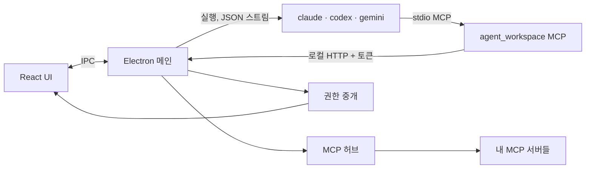

<div align="center">

# Lev (레브)

**코딩 에이전트를 한 곳에서 — Claude Code · OpenAI Codex · Gemini CLI 데스크톱 워크스페이스.**

여러 에이전트를 나란히 돌리고, 에이전트끼리 대화하게 하고, 말로 대시보드를 만들고,
모든 도구 사용은 내가 정한 권한 안에서.

[English](README.md) · **한국어**


</div>

---

## 왜 Lev 인가

코딩 에이전트 CLI 는 강력하지만 터미널마다 따로 놀아요. Lev 는 이걸 하나의 Electron 앱(Windows · macOS · Linux)으로 묶어요.

- **모든 CLI 를 한 곳에서.** Claude Code·Codex·Gemini 세션을 한 목록에서 — 대화 이어가기, 실행 중 입력 대기열, 비용 표시.
- **같이 일하는 에이전트.** 에이전트가 다른 에이전트에게 메시지를 보내고, 하위 에이전트에 일을 나누고, 답을 자동으로 돌려받아요.
- **말로 만드는 대시보드.** "일별 비용을 막대 차트로 보여줘"라고 쓰면 빌더 에이전트가 대시보드를 고쳐 줘요.
- **통제는 내 손에.** 셸 명령·웹 가져오기·MCP 도구·에이전트 간 메시지는 앱 확인 창을 거쳐요. 믿을 수 있는 작업이면 자동 모드 스위치 하나로.

## 기능 둘러보기

### 대화와 에이전트

*(맨 위 화면: "리드" 에이전트가 보낸 질문에 "API 리뷰" 에이전트가 답하는 장면)*

- **슬림한 에이전트 목록** — 상태·비용·CLI 표시, 우클릭으로 이름 바꾸기·열기·초기화·삭제.
- **고정된 "대화" 탭** — 고른 에이전트의 대화를 넓고 읽기 좋게.
- **에이전트 간 메시지:** 한 에이전트가 `aw_send_message` 를 쓰면 받는 쪽엔 *누가* 보냈는지 표시되고, 그 답은 보낸 쪽으로 자동 전달돼요(`wait: true` 면 도구 결과로 바로).
- **자식 에이전트:** 하위 작업을 나눠 맡기고, 모두 끝나면 결과를 부모에게 모아 보고.

<table>
<tr>
<td width="50%"></td>
<td width="50%"></td>
</tr>
<tr>
<td><b>/ 명령</b> — 앱 명령(<code>/model</code>, <code>/clear</code>, <code>/child</code>…), 프로젝트 스킬, 각 CLI 가 알려 주는 명령·스킬 자동완성.</td>
<td><b>Codex·Gemini 도</b> — 세션별 권한 프리셋(읽기 전용 / 파일 편집 / 전체 허용, 네트워크·웹 검색)을 각 CLI 의 옵션으로 맞춰 줘요.</td>
</tr>
</table>

### 말로 만드는 대시보드


- 새 프로젝트는 일부러 단순한 대시보드와 **예시 요청**으로 시작해요 — 눌러서, 고쳐서, 보내기.
- **대시보드 빌더** 에이전트가 `.dashboard/` 를 대신 고쳐요: JSON 위젯(KPI·표·차트·목록…), 샌드박스 **HTML 패널**, 데이터 **스크립트**(Node.js 내장, Python 등은 설치돼 있으면).
- 보드는 작은 **도구**(입력·버튼·파일 저장)도 될 수 있고, 즐겨찾기하면 왼쪽 내비에 바로가기가 생겨요.


대시보드를 보는 중에 에이전트를 고르면 대화가 **떠 있는 창**으로 열려요 — 끌어 옮기고, 크기를 바꾸고, 버블로 접고.

### Git 내장


파일별 스테이징·내리기·변경 취소 · 커밋(여러 줄, 마지막 커밋 고치기) · 히스토리와 파일별 diff · 브랜치(전환, 만들기, 병합된 것 삭제) · 가져오기 / 받기(빨리 감기만) / 올리기(처음엔 upstream 설정). 새 파일의 변경 취소는 휴지통으로 옮겨서 실수로 날리지 않아요.

### MCP 허브 · 비밀값 · OAuth


- MCP 서버를 앱이 **한 번만** 연결해 두고, 모든 세션에 자체 `agent_workspace` 서버를 통해 `<서버>__<도구>` 로 제공해요 — CLI 마다 설정할 필요 없음.
- 프로젝트 `.mcp.json` 의 서버는 실행 전에(그리고 파일이 바뀌면 다시) **승인**을 받아요.
- **도구별 정책:** 자동 허용 / 매번 확인 / 차단(차단한 도구는 에이전트에게 안 보임). 기본값은 도구의 `readOnlyHint` 기준.
- **비밀값**은 OS 키 저장소로 암호화해 `${VAR}` 자리에만 넣어요 — CLI·화면·프로젝트 폴더로 나가지 않아요. 원격 서버는 **OAuth**(PKCE, 루프백 콜백)로 로그인.
- Claude·Gemini 설정의 `"mcpServers": {…}` 블록을 그대로 붙여 넣어도 되고, 헤더의 토큰은 자동으로 비밀값으로 옮겨져요.

### 눈에 보이는 권한

<table>
<tr>
<td width="50%"></td>
<td width="50%"></td>
</tr>
<tr>
<td>Claude 자체 도구(Bash·WebFetch·Skill…)는 <code>--permission-prompt-tool</code> 로 앱에 물어봐요. "항상 허용"은 <code>Bash(npm *)</code> 같은 프로젝트 규칙으로 저장.</td>
<td><b>자동 모드</b>는 확인 창이 뜰 요청을 모두 허용해요 — 차단한 도구는 그대로 막고, 켜져 있는 동안 <code>AUTO</code> 배지로 알려 줘요.</td>
</tr>
</table>

### 프로젝트별 스킬


스킬은 프로젝트의 `.skills/<이름>/SKILL.md` 에 있어요. 기본 스킬 두 개 — **create-skill**(좋은 스킬 쓰는 법)과 **dashboard-builder** — 를 넣어 주고, 채팅에서 `/<스킬> 요청` 으로 어떤 스킬이든 부를 수 있어요.

## 시작하기

**필요한 것**

- Node.js 22 이상 (소스에서 빌드·실행할 때)
- 로그인해 둔 에이전트 CLI 하나 이상: [Claude Code](https://docs.anthropic.com/en/docs/claude-code), [OpenAI Codex](https://github.com/openai/codex), [Gemini CLI](https://github.com/google-gemini/gemini-cli)
- Git (Git 화면용)

```bash
git clone https://github.com/OmnifyAI/LevWorkspace.git
cd LevWorkspace
npm install
npm run dev        # 개발 모드 (핫 리로드)
```

```bash
npm run build      # out/ 으로 빌드
npm start          # 빌드한 앱 실행
npm run dist:win   # 설치 파일 (dist:mac, dist:linux)
```

그다음 **프로젝트 → 새 프로젝트**로 폴더를 고르고, **CLI 연결**에서 감지된 CLI 를 확인한 뒤 에이전트 목록에서 세션을 시작하세요.

## 동작 방식



- 턴마다 CLI 를 비대화 모드로 실행하고(`claude -p --output-format stream-json`, `codex exec --json`, `gemini --output-format stream-json`), CLI 자체 세션 id 로 대화를 이어가요.
- 모든 세션에 `agent_workspace` MCP 서버와 `aw` 명령이 붙어요: 앱 데이터 읽기, 대시보드 스크립트 실행, 다른 에이전트에게 메시지, 중계된 MCP 도구 사용.
- 쓰거나 바깥과 닿는 모든 것 — 도구 권한, "확인" 정책 MCP 호출, 에이전트 간 메시지, 패널 파일 저장 — 은 하나의 권한 중개를 거치고, 횟수 제한과 활동 로그가 남아요.

자세한 내용(데이터 소스, 패널 브리지, CLI 옵션, Windows 메모): [docs/technical.ko.md](docs/technical.ko.md)

## 구조

```
src/main/         Electron 메인: 세션·CLI 실행, MCP 허브, 권한, git, Data API
src/main/data/    대시보드, 쿼리 엔진, HTML 패널, 스크립트, aw 명령, MCP 서버
src/renderer/     React UI (views/, components/)
src/shared/       메인·렌더러 공용 타입
docs/             스크린샷과 기술 메모
```
