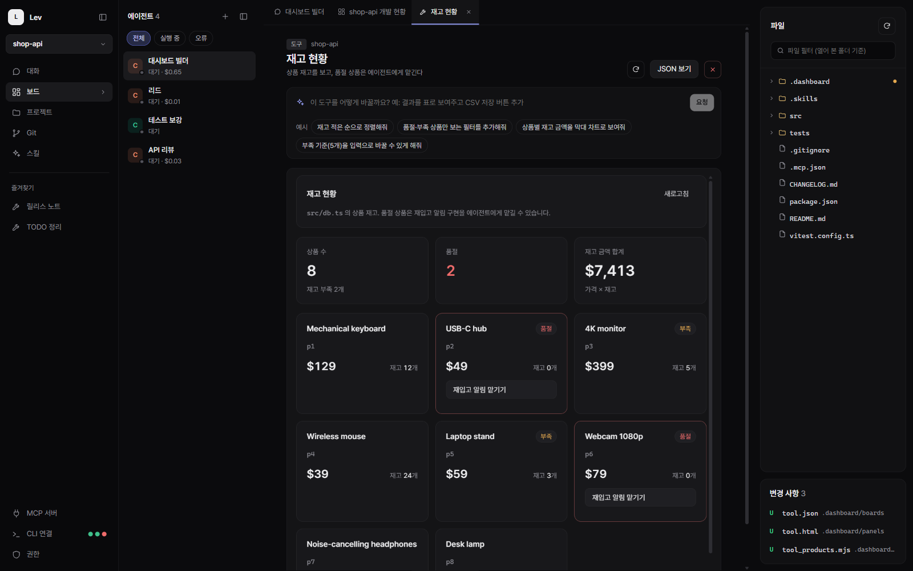
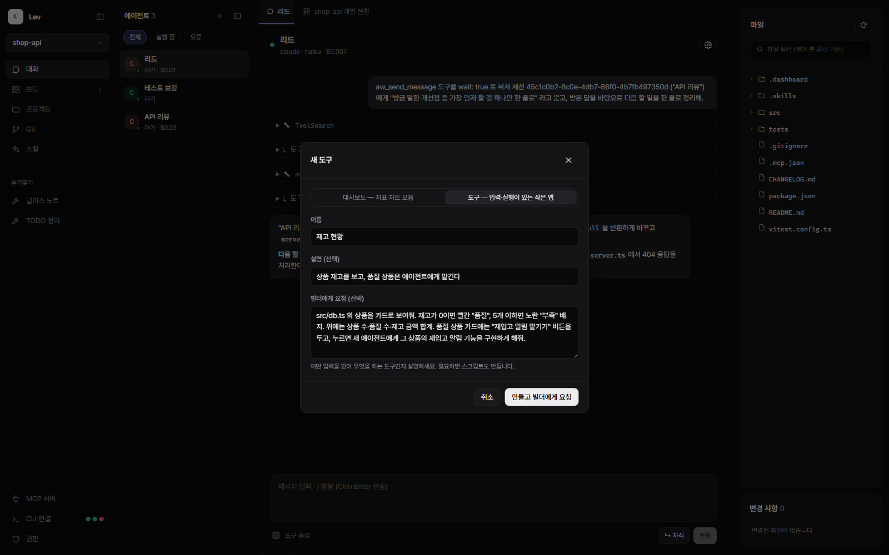
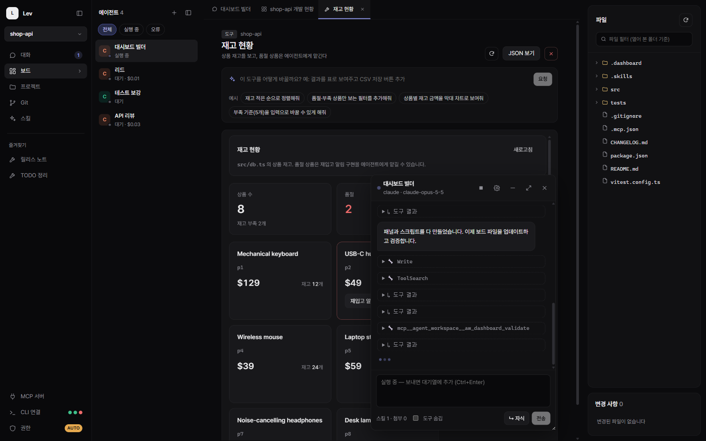

<div align="center">

# Lev (레브)

**필요한 대시보드와 도구, 말하면 에이전트가 만들어 줘요.**

내 프로젝트에 딱 맞는 화면을 기다리지 말고 부탁하세요. Claude Code · Codex · Gemini 에이전트가
프로젝트 안에 직접 만들고, 나는 바로 쓰고, 마음에 안 들면 또 말하면 돼요.

[English](README.md) · **한국어**



<sub>↑ 요청 한 번으로 에이전트가 만든 도구예요. 손으로 고친 곳은 없어요.</sub>

</div>

---

## 나만의 도구 만들기

### 1. 말로 부탁하기



무엇을 보여 줄지, 어떤 버튼이 필요한지, 버튼을 누르면 무슨 일이 일어날지 평소 말하듯 적어요. 코드도 형식도 몰라도 돼요.

### 2. 에이전트가 만드는 걸 지켜보기



대시보드 빌더 에이전트가 프로젝트 안에 화면과 데이터 스크립트를 직접 써요. 파일이 저장될 때마다 도구가 바로 다시 그려져서, 만들어지는 과정이 그대로 보여요.

### 3. 쓰면서 계속 다듬기

맨 위 화면이 위 요청 그대로의 결과예요 (Claude 로 한 번에, 약 $0.65). 품절 상품의 **재입고 알림 맡기기** 버튼을 누르면 새 에이전트가 그 기능을 구현하러 가요.
더 바꾸고 싶으면 위 입력창에 또 말하거나, 에이전트가 추천해 둔 **예시 요청**을 눌러요 — "재고 적은 순으로 정렬해줘", "부족 기준을 입력으로 바꿀 수 있게 해줘"처럼.

## 무엇을 만들 수 있나요

숫자와 차트만 보는 대시보드부터, 입력을 받고 버튼으로 일을 처리하는 작은 앱까지.

- **앱이 모르는 데이터도** — git 기록, 로그 파일, 데이터베이스, 외부 서비스. 에이전트가 필요한 스크립트까지 같이 만들어요.
- **에이전트에게 일 넘기기** — 버튼 하나로 새 에이전트를 만들거나, 일하고 있는 에이전트에게 맡겨요.
- **결과 저장·내보내기** — 도구에서 쓴 내용을 프로젝트에 저장하거나 원하는 곳으로 내보내요.
- **앱과 같은 디자인** — 따로 꾸미지 않아도 앱과 어울리는 카드·표·차트로 나와요.

같은 데모 프로젝트에 있는 다른 보드들:

<table>
<tr>
<td width="50%"></td>
<td width="50%"></td>
</tr>
<tr>
<td><b>개발 현황</b> — 날짜별 커밋, 남은 TODO, 에이전트별 비용.</td>
<td><b>TODO 정리</b> — 코드 속 TODO 를 모아 골라서 에이전트에게 맡기고, 누구에게 맡겼는지 기억.</td>
</tr>
<tr>
<td width="50%"></td>
<td width="50%"></td>
</tr>
<tr>
<td><b>릴리스 노트</b> — 커밋을 골라 에이전트에게 초안을 맡기고, 고쳐서 저장.</td>
<td><b>몰래 일어나는 일은 없어요</b> — 도구가 에이전트에게 일을 넘기거나 파일을 저장하기 전에 먼저 보여줘요.</td>
</tr>
</table>

이런 것도 부탁해 보세요: API 를 눌러서 호출해 보는 테스터, 오늘 에러 로그 요약판, 배포 전 체크리스트, 번역 누락 찾기, 이미지 에셋 갤러리…
자주 쓰는 보드는 별표를 눌러 왼쪽 **즐겨찾기**에 두세요.

## 에이전트


- **모든 CLI 를 한 목록에서** — 상태·비용·CLI 를 한눈에. 우클릭으로 이름 바꾸기·초기화·삭제.
- **에이전트 간 메시지:** 받는 쪽엔 *누가* 보냈는지 표시되고, 답은 보낸 쪽으로 자동 전달돼요. 위 화면은 "리드"가 보낸 질문에 "API 리뷰"가 답하는 장면이에요.
- **자식 에이전트:** 하위 작업을 나눠 맡기고, 모두 끝나면 결과를 부모에게 모아 보고.
- **보면서 대화:** 보드를 보다가 에이전트를 고르면 대화가 떠 있는 창으로 열려요 — 끌어 옮기고, 버블로 접고.

<table>
<tr>
<td width="50%"></td>
<td width="50%"></td>
</tr>
<tr>
<td><b>/ 명령</b> — 앱 명령, 프로젝트 스킬, 각 CLI 가 알려 주는 명령·스킬 자동완성.</td>
<td><b>Codex·Gemini 도</b> — 세션별 권한 프리셋(읽기 전용 / 파일 편집 / 전체 허용, 네트워크·웹 검색).</td>
</tr>
</table>

## 권한

<table>
<tr>
<td width="50%"></td>
<td width="50%"></td>
</tr>
<tr>
<td>Claude 자체 도구(Bash·WebFetch·Skill…)는 먼저 앱에서 물어봐요. "항상 허용"하면 이 프로젝트에서는 다시 묻지 않아요.</td>
<td><b>자동 모드</b>는 확인 창이 뜰 요청을 — 대시보드 스크립트까지 — 모두 허용하고, 켜져 있는 동안 <code>AUTO</code> 배지로 알려 줘요.</td>
</tr>
</table>

## 스킬


스킬은 프로젝트에 저장해 두고 다시 쓰는 작업 지침이에요. 기본으로 **dashboard-builder**(보드 만드는 법)와 **create-skill**(좋은 스킬 쓰는 법)을 넣어 주고, 채팅에서 `/` 를 치고 이름을 고르면 어떤 스킬이든 부를 수 있어요.

## 시작하기

**필요한 것**

- Node.js 22 이상
- 로그인해 둔 에이전트 CLI 하나 이상: [Claude Code](https://docs.anthropic.com/en/docs/claude-code), [OpenAI Codex](https://github.com/openai/codex), [Gemini CLI](https://github.com/google-gemini/gemini-cli)

```bash
git clone https://github.com/OmnifyAI/LevWorkspace.git
cd LevWorkspace
npm install
npm run dev        # 개발 모드 (핫 리로드)
```

```bash
npm run build      # out/ 으로 빌드
npm start          # 빌드한 앱 실행
npm run dist:win   # 설치 파일 (dist:mac, dist:linux)
```

그다음 **프로젝트 → 새 프로젝트**로 폴더를 고르고, **CLI 연결**에서 감지된 CLI 를 확인한 뒤, **보드 → + 새 도구**에서 원하는 것을 적어 보세요.

## 더 알아보기

보드·스크립트·에이전트 도구·권한이 안에서 어떻게 동작하는지: **[docs/technical.ko.md](docs/technical.ko.md)**

## 라이선스

[MIT](LICENSE)
