<div align="center">

# Lev

**A desktop workspace where your coding agents build the dashboards and tools you need.**

Run Claude Code, OpenAI Codex and Gemini CLI side by side, ask them for a dashboard or a small tool in plain words,
and use what they build — with every action behind a permission you control.

**English** · [한국어](README.ko.md)

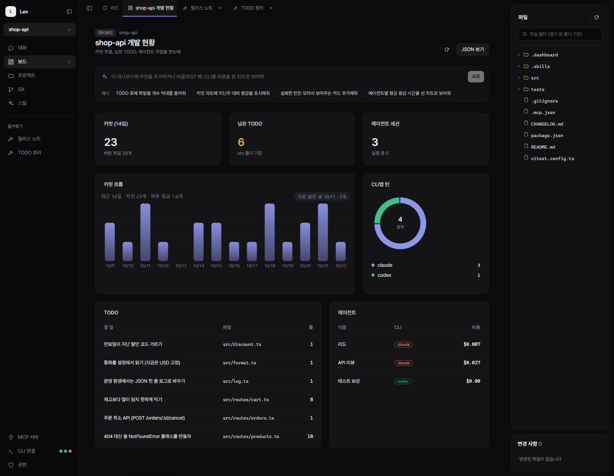

</div>

---

## Why Lev

Coding-agent CLIs are powerful, but their work disappears into terminal scrollback. Lev gives each project **boards** — dashboards and small tools — that agents build for you and you keep using:

- **Dashboards you describe.** Type "show commits per day for the last two weeks" and the builder agent edits the board in front of you.
- **Tools, not just charts.** A board can take input, run a script, save files and hand work to an agent — a release-notes writer, a TODO triager, whatever your project needs.
- **Agents that work together.** Claude Code, Codex and Gemini sessions in one list; agents can message each other and delegate to child agents.
- **You stay in control.** Scripts, file saves, messages to agents and shell commands go through an in-app confirmation — or one AutoMode switch when you trust the run.

## Dashboards

Every project has its own **boards**. Tell the dashboard-builder agent what you want to see and it builds it:

- **Numbers, tables, lists and charts** — ready-made widgets, laid out on a grid.
- **Anything custom** — interactive charts, filters, your own layouts, styled to match the app.
- **Data from anywhere** — small scripts pull in what the app doesn't know: git history, log files, external services. The dashboard above counts commits and TODOs this way.

<table>
<tr>
<td width="50%">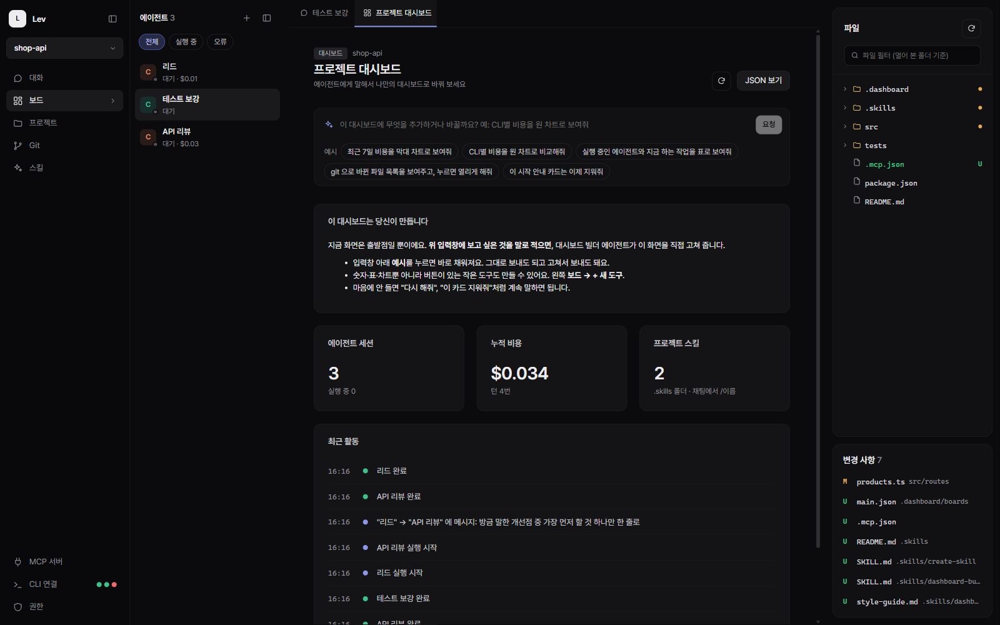</td>
<td width="50%">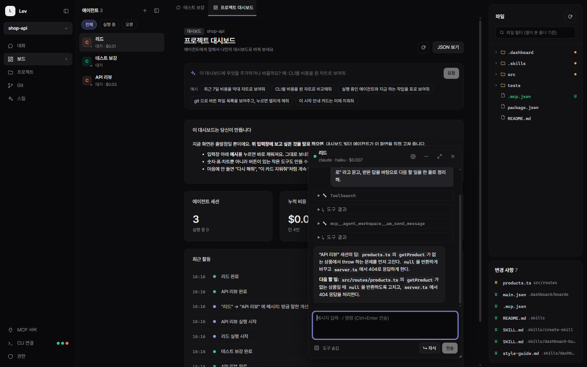</td>
</tr>
<tr>
<td><b>Start simple, grow it by asking.</b> New projects get a minimal board and <b>example requests</b> — click one, edit it, send it to the dashboard-builder agent.</td>
<td><b>Keep talking while you look.</b> Pick an agent from a board and its chat opens in a floating window you can drag, resize or fold into a bubble.</td>
</tr>
</table>

## Tools

A **tool** is a board that does something — a small app for your project. Agents build it the same way — and it can put agents to work.

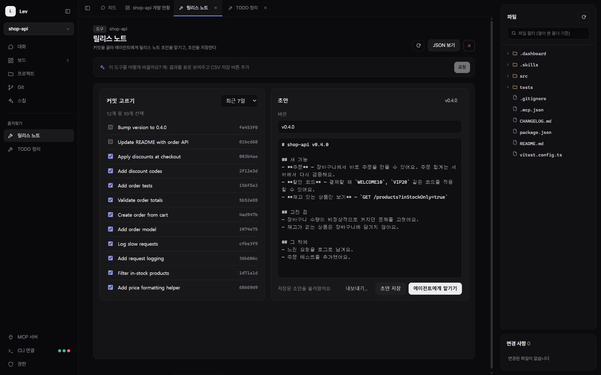

**Release notes** — pick commits from the last week, press *Ask an agent*, and a new session writes the draft into the tool's data folder. Edit it, save versions, export it anywhere.

<table>
<tr>
<td width="50%">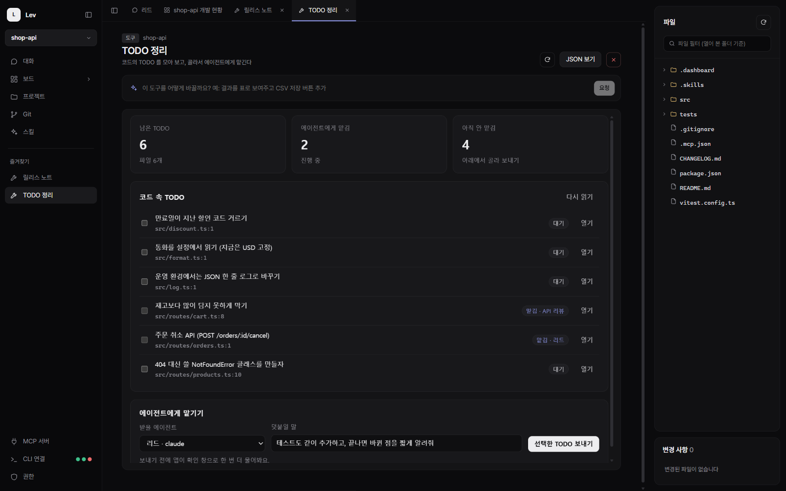</td>
<td width="50%">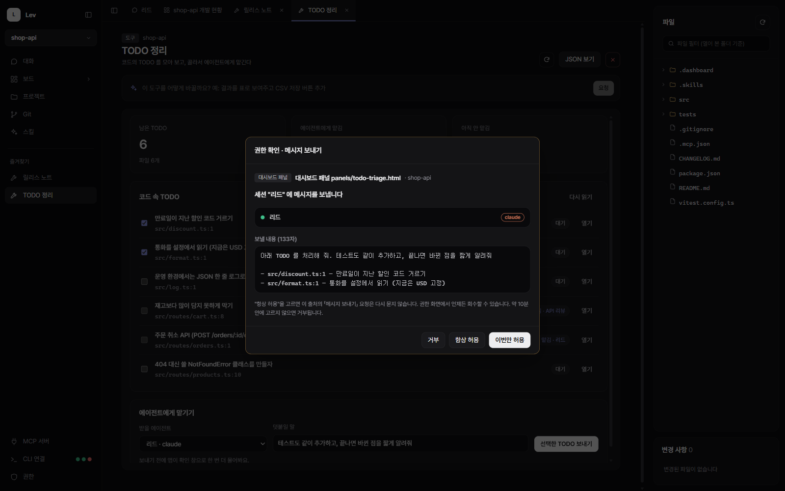</td>
</tr>
<tr>
<td><b>TODO triage</b> — a script collects TODO comments from the code; pick some and send them to an agent. The tool remembers what was handed to whom.</td>
<td><b>Nothing happens behind your back.</b> When a tool sends a message, creates a session or saves a file, Lev shows exactly what will happen first.</td>
</tr>
</table>

Star a board to pin it to the sidebar — the two tools above live under **즐겨찾기** (Favorites).

## Agents

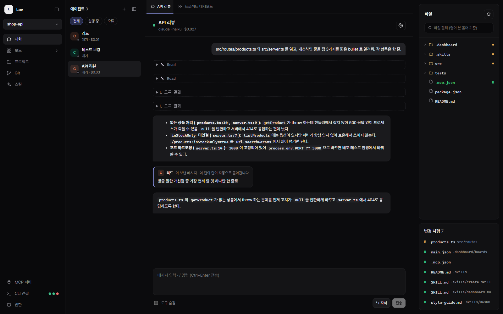

- **One list for every CLI** — status, cost and provider at a glance; right-click to rename, reset or delete.
- **Agent-to-agent messages:** the receiver sees *who* sent it, and its answer goes back to the sender automatically. Above, "API 리뷰" answers a question from "리드".
- **Child agents:** delegate sub-tasks; results are reported to the parent when all children finish.

<table>
<tr>
<td width="50%">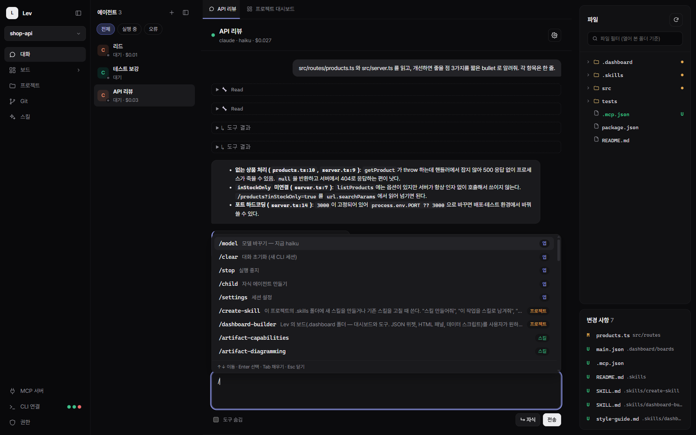</td>
<td width="50%">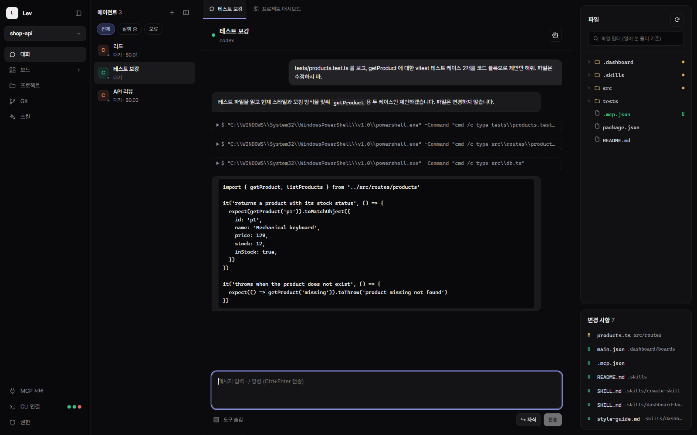</td>
</tr>
<tr>
<td><b>/ commands</b> — app commands, project skills, and the commands and skills each CLI reports.</td>
<td><b>Codex and Gemini too</b> — per-session permission presets (read-only / edit / full, network & web search).</td>
</tr>
</table>

## Permissions

<table>
<tr>
<td width="50%">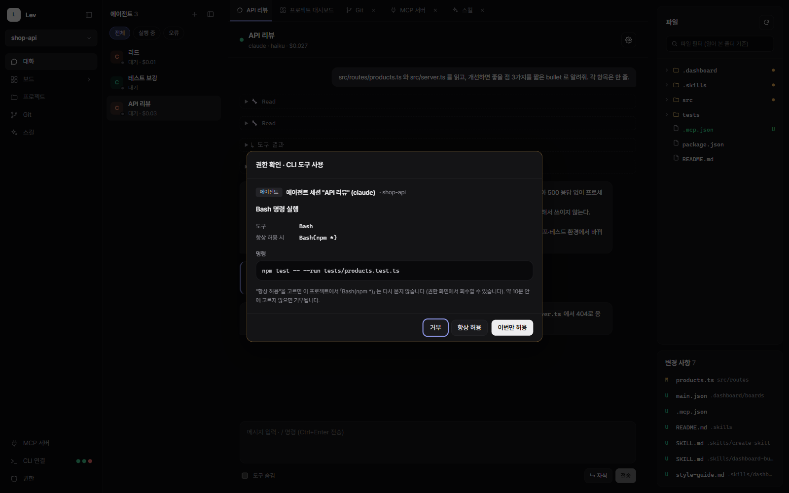</td>
<td width="50%">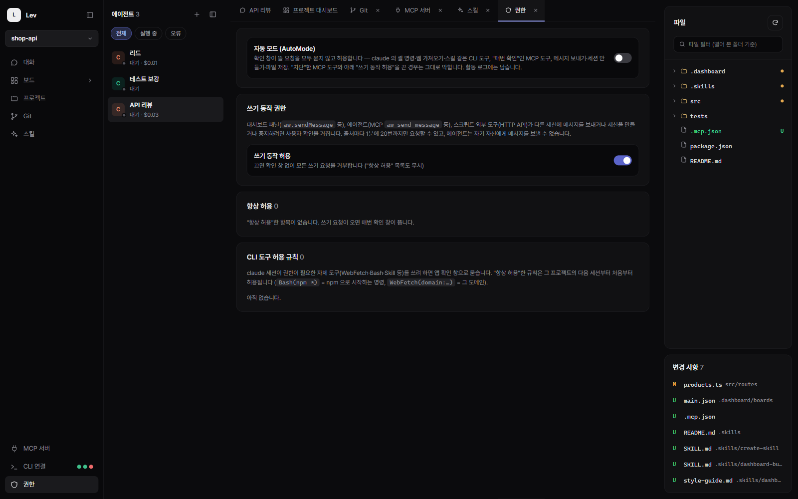</td>
</tr>
<tr>
<td>Claude's own tools (Bash, WebFetch, Skill…) ask you in the app first. "Always allow" remembers it for this project.</td>
<td><b>AutoMode</b> approves everything that would prompt — including dashboard scripts — and shows an <code>AUTO</code> badge while it's on.</td>
</tr>
</table>

## Skills

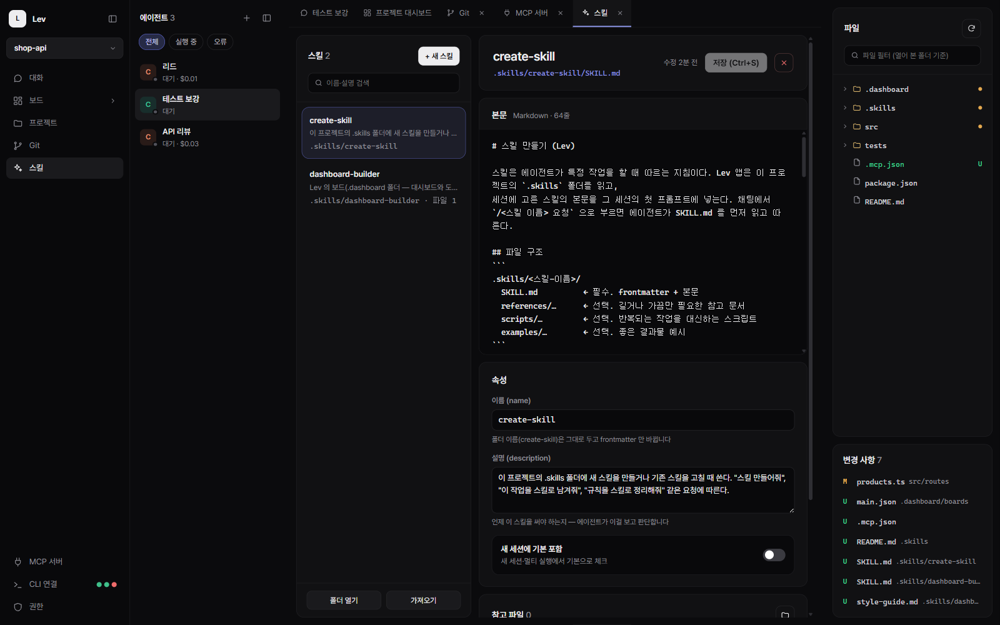

Skills are reusable instructions stored with each project. Lev ships **dashboard-builder** (how to build boards) and **create-skill** (how to write a good skill); call any skill from chat by typing `/` and its name.

## Getting started

**Requirements**

- Node.js 22 or later
- At least one agent CLI, logged in: [Claude Code](https://docs.anthropic.com/en/docs/claude-code), [OpenAI Codex](https://github.com/openai/codex), or [Gemini CLI](https://github.com/google-gemini/gemini-cli)

```bash
git clone https://github.com/OmnifyAI/LevWorkspace.git
cd LevWorkspace
npm install
npm run dev        # development with hot reload
```

```bash
npm run build      # build to out/
npm start          # run the built app
npm run dist:win   # installer (also dist:mac, dist:linux)
```

Then: **프로젝트 → 새 프로젝트** to pick a folder, **CLI 연결** to check which CLIs were detected, and type what you want to see into the dashboard's request box.

> The UI is currently in Korean. English UI is planned.

## Learn more

How boards, scripts, agent tools and permissions work under the hood: **[docs/technical.md](docs/technical.md)**

## License

[MIT](LICENSE)
