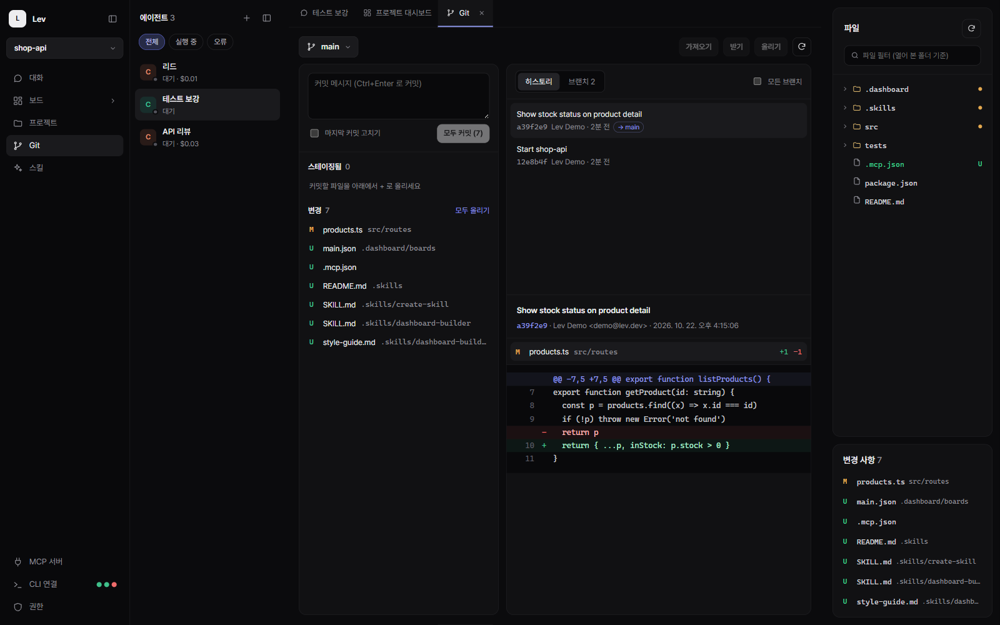
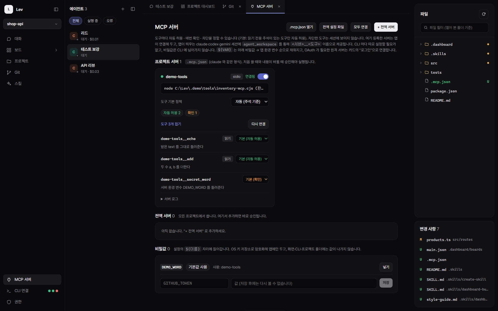
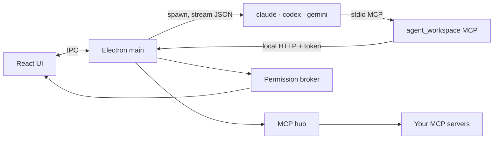

<div align="center">

# Lev

**One desktop workspace for your coding agents — Claude Code, OpenAI Codex and Gemini CLI.**

Run several agents side by side, let them talk to each other, build your own dashboards by just asking,
and keep every tool call behind a permission you control.

**English** · [한국어](README.ko.md)


</div>

---

## Why Lev

Coding-agent CLIs are powerful but live in separate terminals. Lev wraps them in one Electron app (Windows · macOS · Linux):

- **Every CLI, one place.** Claude Code, Codex and Gemini sessions in one list — resumable conversations, queued prompts, cost tracking.
- **Agents that work together.** An agent can message another agent, delegate to child agents, and get the reply back automatically.
- **Dashboards you describe.** Type "show cost per day as a bar chart" and a builder agent edits the dashboard for you.
- **You stay in control.** Shell commands, web fetches, MCP tools and cross-agent messages go through an in-app confirmation — or a single AutoMode switch when you trust the run.

## Feature tour

### Conversations and agents

*(screenshot at the top: the "API 리뷰" agent answering a question that the "리드" agent sent it)*

- **Slim agent list** with status, cost and provider; right-click to rename, open, reset or delete.
- **Pinned 대화 (chat) tab** — the selected agent's conversation, wide and readable.
- **Agent-to-agent messages:** when one agent calls `aw_send_message`, the receiver sees *who* sent it, and its answer is delivered back to the sender automatically (or as the tool result with `wait: true`).
- **Child agents:** delegate sub-tasks; results are reported to the parent when all children finish.

<table>
<tr>
<td width="50%"></td>
<td width="50%"></td>
</tr>
<tr>
<td><b>/ commands</b> — app commands (<code>/model</code>, <code>/clear</code>, <code>/child</code>…), project skills, and the commands and skills each CLI reports.</td>
<td><b>Codex and Gemini too</b> — per-session permission presets (read-only / edit / full, network & web search) mapped to each CLI's own flags.</td>
</tr>
</table>

### Dashboards you build by asking


- Each project starts with a deliberately simple dashboard and **example requests** — click one, edit it, send it.
- A **dashboard-builder** agent edits `.dashboard/` for you: JSON widgets (KPI, table, chart, list…), sandboxed **HTML panels**, and data **scripts** (Node.js built-in; Python and others if installed).
- Boards can also be small **tools** (forms, buttons, file save) — favorite them to pin them in the sidebar.


Pick an agent while you're on a dashboard and its chat opens in a **floating window** — drag it, resize it, or fold it into a bubble.

### Git built in



Stage, unstage and discard per file · commit (multi-line, amend) · history with per-file diffs · branches (switch, create, delete merged) · fetch / pull (fast-forward only) / push (sets upstream on first push). Untracked files are moved to the trash on discard, so nothing is lost by accident.

### MCP hub, secrets and OAuth



- Lev connects your MCP servers **once** and exposes them to every session through its own `agent_workspace` server as `<server>__<tool>` — no per-CLI config.
- Project servers from `.mcp.json` need **your approval** before they run (and again when the file changes).
- **Per-tool policy:** allow / ask / block (blocked tools are hidden from agents). Defaults follow each tool's `readOnlyHint`.
- **Secrets** are encrypted with the OS keychain and substituted into `${VAR}` — they never reach the CLI, the renderer or your project folder. Remote servers can sign in with **OAuth** (PKCE, loopback callback).
- Paste a `"mcpServers": {…}` block from Claude or Gemini config as-is; tokens in headers are moved into secrets automatically.

### Permissions you can see

<table>
<tr>
<td width="50%"></td>
<td width="50%"></td>
</tr>
<tr>
<td>Claude's own tools (Bash, WebFetch, Skill…) ask through Lev via <code>--permission-prompt-tool</code>. "Always allow" saves a project rule such as <code>Bash(npm *)</code>.</td>
<td><b>AutoMode</b> approves everything that would prompt — while blocked tools stay blocked and an <code>AUTO</code> badge reminds you it's on.</td>
</tr>
</table>

### Skills per project


Skills live in your project's `.skills/<name>/SKILL.md`. Lev ships two defaults — **create-skill** (how to write a good skill) and **dashboard-builder** — and lets you call any skill from chat with `/<skill> request`.

## Getting started

**Requirements**

- Node.js 22 or later (to build and run from source)
- At least one agent CLI, logged in: [Claude Code](https://docs.anthropic.com/en/docs/claude-code), [OpenAI Codex](https://github.com/openai/codex), or [Gemini CLI](https://github.com/google-gemini/gemini-cli)
- Git (for the Git view)

```bash
git clone https://github.com/OmnifyAI/LevWorkspace.git
cd LevWorkspace
npm install
npm run dev        # development with hot reload
```

```bash
npm run build      # build to out/
npm start          # run the built app
npm run dist:win   # installer (also dist:mac, dist:linux)
```

Then: **프로젝트 → 새 프로젝트** to pick a folder, **CLI 연결** to check which CLIs were detected, and start a session from the agent list.

> The UI is currently in Korean. English UI is planned.

## How it works



- Each turn runs the CLI headless (`claude -p --output-format stream-json`, `codex exec --json`, `gemini --output-format stream-json`) and resumes the CLI's own session id.
- Every session gets the `agent_workspace` MCP server and an `aw` command: read app data, run dashboard scripts, message other agents, use your routed MCP tools.
- Anything that writes or reaches out — tool permissions, MCP calls on "ask", cross-agent messages, panel file saves — goes through one permission broker with rate limits and an audit trail in the activity log.

Detailed notes (data sources, panel bridge, CLI flags, Windows quirks): [docs/technical.ko.md](docs/technical.ko.md) (Korean).

## Project layout

```
src/main/         Electron main: sessions & CLI runner, MCP hub, permissions, git, Data API
src/main/data/    dashboards, query engine, HTML panels, scripts, aw command, MCP server
src/renderer/     React UI (views/, components/)
src/shared/       types shared by main and renderer
docs/             screenshots and technical notes
```
