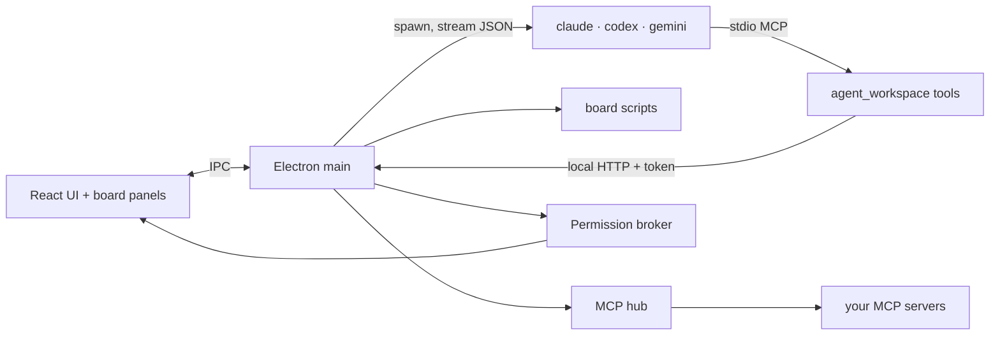

# Lev — technical notes

**English** · [한국어](technical.ko.md) · back to [README](../README.md)

## How it works



- Each turn runs the CLI headless with the prompt on stdin and resumes the CLI's own session id:
  - claude: `claude -p --output-format stream-json --verbose [--resume id]`
  - codex: `codex exec --json --skip-git-repo-check [resume id] -`
  - gemini: `gemini --output-format stream-json [--resume id]`
- Every session gets the stdio MCP server `agent_workspace` (`aw_*` tools), an `aw` command on PATH, and `AGENT_WORKSPACE_API` / `_TOKEN` / `_PROJECT` environment variables for the local Data API (127.0.0.1, new token per launch).
- Anything that writes or reaches out goes through one permission broker: an in-app prompt (deny / allow once / always allow), a 20-per-minute limit per origin, and an activity log entry.

## Boards

Boards live in the project's `.dashboard/` folder and redraw as soon as a file changes.

```
.dashboard/
  boards/<id>.json   one board per file (main.json is the default dashboard)
  panels/*.html      HTML panels, shared by all boards
  scripts/*          data scripts, shared by all boards
  data/              files saved by panels and tools
  media/             images, GIFs, videos
```

A board file:

```json
{
  "version": 1,
  "title": "shop-api",
  "kind": "dashboard",
  "suggestions": ["Show commits per day as a bar chart"],
  "widgets": [
    { "id": "todos", "type": "kpi", "title": "TODOs", "w": 4,
      "query": { "source": "script", "params": { "name": "todos.mjs" }, "agg": { "value": { "op": "count" } } } },
    { "id": "commits", "type": "html", "title": "Commit activity", "w": 8, "src": "panels/commits.html" }
  ]
}
```

- `kind`: `"dashboard"` (widgets on a 12-column grid) or `"tool"` (usually one HTML panel with `"height": "fill"`).
- Widget types: `kpi`, `table`, `list`, `chart` (bar / line / pie), `markdown`, `media`, `pipeline`, `html`.
- `query` runs against app data sources — `sessions`, `turns`, `activity`, `skills`, `files`, `git`, `mcpCalls`, `script`, `file` … with `where`, `since`, `groupBy`, `agg`, `sort`, `limit`.
- `suggestions` show up as example-request chips under the board's request box.

### HTML panels

Panels run in a sandboxed iframe with a strict CSP (no network unless `"network": true`; CDNs only). Theme variables (`--aw-*`) and base classes (`.aw-card`, `.aw-table`, `.aw-btn` …) are injected so panels match the app. Data comes only through `window.aw`:

| | |
|---|---|
| Read | `aw.query(q)`, `aw.schema()`, `aw.run(script, args)`, `aw.readJSON(path)`, `aw.readFile(path)`, `aw.listFiles(dir)` |
| Act (asks first) | `aw.createSession({title, prompt, provider})`, `aw.sendMessage(id, text)`, `aw.stopSession(id)`, `aw.saveJSON(path, v)`, `aw.saveFile(path, text)` |
| Export | `aw.saveAs(content, {name})` — OS save dialog |
| Navigate | `aw.openSession(id)`, `aw.openFile(rel)` |
| Events | `aw.on('state', fn)` — app state changed |

### Scripts

- Node.js (`.mjs`) runs on the app's bundled Node, so nothing needs to be installed. `.py`, `.ps1`, `.sh`, `.rb`, `.php` work if the runtime exists.
- Arguments arrive as JSON on stdin and in `AW_SCRIPT_ARGS`; the script prints one JSON value to stdout.
- 30 s default timeout (max 300 s), 5 MB output.
- A script needs your approval the first time and whenever its content changes (skipped while AutoMode is on).

The full builder guide that agents follow is written into each project as `.skills/dashboard-builder/SKILL.md`.

## Agents

- **Agent-to-agent messages:** `aw_send_message` shows the sender on the receiving side and returns the receiver's answer automatically. With `wait: true` the answer comes back as the tool result (up to 4 min). Mutual waits are refused.
- **Child agents:** `aw_create_session` with a parent, or a `<delegate agent=".." title="..">` block from the lead agent. Results are reported to the parent when all children finish (depth 2, 5 per turn).
- **Slash commands:** app commands (`/model`, `/clear`, `/stop`, `/child`, `/settings`), project skills, and whatever each CLI reports at startup.

## Permissions

- **Claude's own tools:** `-p` mode has no permission prompt, so Lev passes `--permission-prompt-tool mcp__agent_workspace__aw_permission_prompt`. "Always allow" becomes a project rule (`Bash(npm *)`, `WebFetch(domain:…)`) passed as `--allowedTools` next time.
- **Codex / Gemini:** permission presets map to CLI flags — codex `--sandbox read-only|workspace-write|danger-full-access -c approval_policy=never` (+ network, `web_search=disabled`), gemini `--approval-mode default|auto_edit|yolo`.
- **AutoMode:** approves everything that would prompt — CLI tools, MCP tools on "ask", messages, sessions, file saves, scripts. Blocked MCP tools stay blocked and the rate limit stays on.

## MCP hub

Lev connects MCP servers from the project's `.mcp.json` and the global `userData/mcp/servers.json` once, and exposes them to every session through `agent_workspace` as `<server>__<tool>`.

- Project servers need approval before they run (and again when the file changes).
- Per-tool policy: allow / ask / block. Defaults follow `readOnlyHint`.
- Secrets are encrypted with the OS keychain (`safeStorage`) and substituted into `${VAR}` / `${VAR:-default}`. They never reach the CLI, the renderer or the project folder.
- Remote servers can sign in with OAuth (PKCE, loopback callback).

## Windows notes

- CLIs installed after the app started are found by re-reading PATH from the registry.
- PowerShell 5.1 turns Korean output into CP949, so the first prompt tells agents to read files with `cmd /c type`, `findstr` or `node -e` and to write with `-Encoding UTF8`.

## Project layout

```
src/shared/            types shared by main and renderer
src/main/store.ts      JSON store (userData/data/workspace.json)
src/main/data/         Data API: sources, query engine, boards, panels, scripts, HTTP server, aw command, MCP server
src/main/providers.ts  CLI commands, stream parsing, detection
src/main/runner.ts     session processes, streaming, queue
src/main/workspace.ts  domain logic, child agents, messages
src/main/permissions.ts permission broker
src/main/mcpHub.ts     external MCP servers
src/main/git.ts        Git view
src/renderer/src/      React UI (views/, components/)
```
